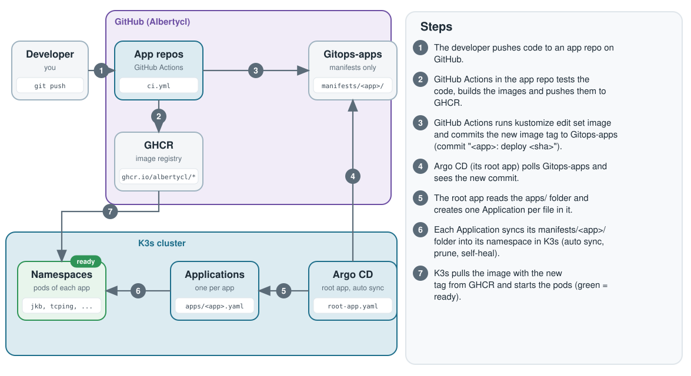

# Gitops-apps

The one Git repo that holds the Kubernetes manifests of every demo app. Argo CD on a local K3s cluster watches it and deploys what is in it.



## Apps

| App | What it does | Live demo | Source repo | Manifests |
|-----|--------------|-----------|-------------|-----------|
| Jkb-with-country | ISP status board for a network operations team | [jkb.albertycliu.xyz](https://jkb.albertycliu.xyz) | [Jkb-with-country](https://github.com/Albertycl/Jkb-with-country) | `manifests/jkb-with-country/` |
| Tcping | Network diagnostics (TCP ping, MTR, dig, curl) from simulated probes | [tcping.albertycliu.xyz](https://tcping.albertycliu.xyz) | [Tcping](https://github.com/Albertycl/Tcping) | `manifests/tcping/` |
| Syslog-demo | Syslog alert portal with acknowledge, mute and audit log | [syslog.albertycliu.xyz](https://syslog.albertycliu.xyz) | [Syslog-demo](https://github.com/Albertycl/Syslog-demo) | `manifests/syslog-demo/` |
| Outage-report | Outage detector concept demo (made-up data) | [outage.albertycliu.xyz](https://outage.albertycliu.xyz) | [Outage-report](https://github.com/Albertycl/Outage-report) | `manifests/outage-report/` |
| Network-diag-tool | Network diagnostic reports: admin UI and user UI | [admin](https://admin.albertycliu.xyz) and [diag](https://diag.albertycliu.xyz) | [Network-diag-tool](https://github.com/Albertycl/Network-diag-tool) | `manifests/network-diag-tool/` |
| FQDN Search in multiple FW and LTM comparing | Search an IP, FQDN or object name in parsed network configs | [fqdn-seachtool.albertycliu.xyz](https://fqdn-seachtool.albertycliu.xyz) | [Fqdn-firewall-ltm-compare](https://github.com/Albertycl/Fqdn-firewall-ltm-compare) | `manifests/fqdn-compare/` |
| Country-availability | Checks if a website opens from several countries (simulated probes) | internal only, no public URL | [Country-availability](https://github.com/Albertycl/Country-availability) | `manifests/country-availability/` |
| cluster-issuers | Infra: Let's Encrypt ClusterIssuers for cert-manager | none | none | `manifests/cluster-issuers/` |
| otel-operator | Infra: OpenTelemetry Operator (Helm chart 0.122.0, no folder here) | none | none | `apps/otel-operator.yaml` |

All demo data is made up. The admin UI of Network-diag-tool has no login on purpose (basic auth was removed for the interview demo), so it is open to the internet.

## How it works

- **App-of-apps.** `argocd/root-app.yaml` is the only thing applied by hand. It watches `apps/`, and every file there is one Argo CD Application that points at its folder under `manifests/`.
- **Auto sync, prune and self-heal.** Every Application has these on, so Git is the truth: a change made by hand in the cluster is undone, and a file removed from Git is removed from the cluster.
- **CI writes the image tag.** The GitHub Actions workflow of each app repo builds the images, pushes them to GHCR, runs `kustomize edit set image` in `manifests/<app>/` and commits "<app>: deploy <sha>" here. Do not edit the `newTag` values by hand.
- **No secrets in this repo.** Manifests only name Secrets (for example `secretKeyRef`); the Secrets are created in the cluster by hand.

## Add a new app

1. Create `manifests/<app>/` with `namespace.yaml`, the Deployments and Services, and a `kustomization.yaml` (the CI job edits its `images:` list). Add a `Certificate` and an `IngressRoute` only if the app gets a public hostname.
2. Create `apps/<app>.yaml`, an Application that points at `manifests/<app>/` with automated sync, prune and self-heal.
3. Commit and push this repo first, because the app's CI job needs `manifests/<app>/kustomization.yaml` to exist.
4. Add a deploy key: its public half goes on this repo with write access, its private half is the secret `GITOPS_DEPLOY_KEY` in the app repo. Copy the `update-gitops` job into the app repo's CI and edit its path and image names.
5. Push the app repo. After the first CI run, set each GHCR package to public, or the pods show `ImagePullBackOff`.
6. Once Argo CD has created the namespace, create the app Secrets in the cluster by hand (names and keys are in the manifests, values are not).

## Roll back

`git revert` the "<app>: deploy <sha>" commit in this repo and push. Argo CD syncs the old tag. `kubectl rollout undo` does not work here, because self-heal puts the Git version back.

## Layout

```
argocd/root-app.yaml        the root Application (bootstrap)
apps/                       one Argo CD Application per app (and per infra part)
manifests/<app>/            Kubernetes YAML of that app, with kustomization.yaml
manifests/cluster-issuers/  cert-manager ClusterIssuers (Let's Encrypt, DNS-01)
docs/architecture.svg       the picture above
```

## Bootstrap

```
kubectl apply -f argocd/root-app.yaml
```
